# MFD-24

*Multi-Function Display, 24 hours: the cockpit's screen, and the day in one turn of the hour hand.*

[](https://github.com/amorroma1/mfd-24/actions/workflows/build.yml)

**English** · [Français](docs/i18n/README.fr.md) · [Deutsch](docs/i18n/README.de.md) · [Italiano](docs/i18n/README.it.md) · [日本語](docs/i18n/README.ja.md) · [中文](docs/i18n/README.zh.md)

A 24-hour instrument dial for people who stand watches — pilots, mariners, UAV crews, duty
officers. One turn of the hour hand per day, your shift drawn as an arc of that day, a dead-man's
monitor that escalates to SOS and leaves a record, and the telemetry a watch actually runs on.

Everything works offline except the weather and the once-a-day release check. No companion app,
no account, no analytics. GPL-3.0.

| Interactive | Always-on |
|---|---|
| 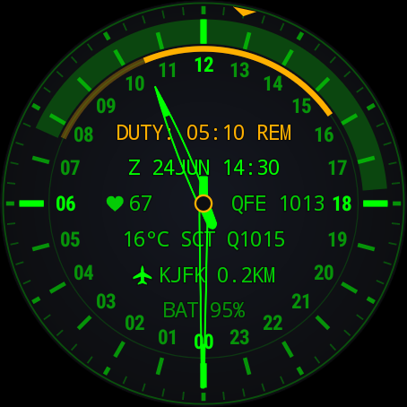 | 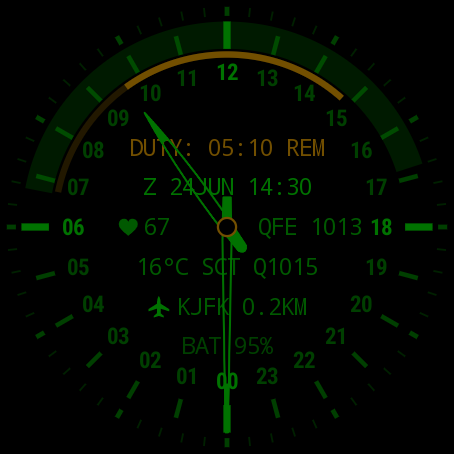 |

*A watch under way at New York JFK. The same face in both shots: always-on is the interactive dial,
dimmed, minus the seconds cursor and the background wash.*

**Wear OS 3.0+ (API 30).** Built and worn on a TicWatch Pro 3 Ultra (454 × 454).
**[Install →](docs/INSTALL.md)**

---

## What you get

| | |
|---|---|
| **24-hour dial** | One revolution per day. Noon up or midnight up. Minutes on their own ring; the second is a cursor that steps, so nothing sweeps. |
| **Watch timer** | Start now or book ahead. An arc spans the hours on duty and dims as they are served; `DUTY: 04:40 REM` counts down. Both boundaries beep and buzz with the screen off. A finished watch clears itself an hour later. |
| **Vigilance monitor** | Off by default. Every 5/10/15 min it wants a sign of life; thirty seconds later it sounds SOS in bursts and leaves `MAN DOWN` with the Zulu moment on the dial. Optionally it notes your pulse during the missed check, beside your last reading on the move. |
| **Log export** | The incident log leaves the watch as a **QR code** for a phone camera or as **sound** — Bell 202 AFSK, decoded by `minimodem`. The sound carries everything; the QR carries what fits and says so. [Channels and limits ↓](#export) |
| **Zulu + date-time group** | `Z 11NOV 13:05`, the clock a log entry is written in. |
| **Weather** | Temperature, METAR-style condition and QNH. At an aerodrome it is that field's **own METAR**; everywhere else Open-Meteo. Refreshed every 30 minutes. |
| **5 km site lock** | Names the nearest airfield, port, heliport or spaceport from 9,649 sites in a 194 KB on-device index. Military sites are drawn in the accent colour. |
| **Nadir, sun and moon** | Daylight shaded across the hour band, computed offline. The sun and the moon sit at their true hour angles — point a mark at the real thing and the dial is a **compass**. The moon carries its honest phase. |
| **Sensor slots** | Two optional readouts beside the hub: heart rate, the day's steps, or station pressure. Off by default; they run while the screen is on, and in always-on the pulse is re-read once a minute while the watch is worn. [How that window paces itself ↓](#pulse-window) |
| **Always-on** | The same dial, dimmed. `AUTO` thins it to every other pixel after sunset — never during a night watch. |
| **Direct boot** | Draws populated before the watch is unlocked. |

## In action

| A missed check, answered late | JFK to Heathrow, the whole flight | Waking |
|---|---|---|
| 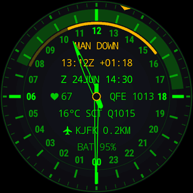 | 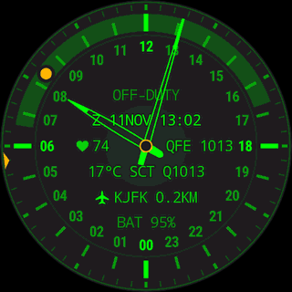 | 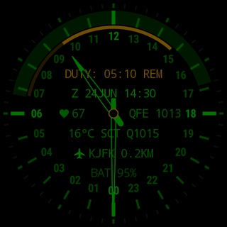 |
| The SOS went unanswered: `MAN DOWN`, the Zulu moment, a mark on the arc. One tap answers with `TAP AGAIN`; a second, inside a second, clears it — a sleeve cannot. | BA 178 on 11 November 2026, the real timetable, in 36 seconds: an eight-hour watch started at the gate, the site and its METAR gone five minutes after rotation, the cabin at 790 hPa, sunset over the Atlantic, `EGLL` back on short final, and the hands moved to London on the ground. | Only the light arrives. Always-on wears the same hues, so there is nothing to cross-fade. |

*The flight runs 36 seconds on purpose — a whole day for whoever wants to watch one; the ground
goes slowly and the ocean fast. The landing alone, at full speed:
[landing.gif](docs/media/landing.gif).*

<details>
<summary><b>Two things people ask about the flight</b></summary>

<br>

**Why do the hands change zone only after landing?** A watch takes its time zone from the phone,
and the phone finds a network on the ground. Until then the dial keeps the departure zone — which
is also why, over the ocean, the sun mark stands to the right of the daylight band: the mark is the
sun's true hour angle, the band is the day in the watch's zone, and the gap between them is exactly
the zone's lag. The glide on the ground closes it.

**What is real in it?** The timetable is BA 178's of that day and the positions follow its usual
North Atlantic routing, fed to the face as GPS fixes; the weather and the astronomy are the face's
own work from them. Pulse, cabin pressure and battery are staged on the emulator, because an
emulator has no wrist.

</details>

## Install

Download `app-earth-release.apk` from the
[latest release](https://github.com/amorroma1/mfd-24/releases/latest) and sideload it. Wear OS
has no sideloading UI, so this is an ADB job:

```
adb connect 192.168.1.50:41234
adb install -r app-earth-release.apk
```

Then pick MFD-24 in the watch's own face picker. No computer? A phone can run the same ADB
handshake: **[Wear Installer 2](https://play.google.com/store/apps/details?id=org.freepoc.wearinstaller2)**
or **[Bugjaeger](https://play.google.com/store/apps/details?id=eu.sisik.hackendebug)**, both
third-party, both walked through in the guide.
**[Full guide — three routes, from a phone-only install to building from source →](docs/INSTALL.md)**

<details>
<summary><b>Updates, and why this is not on Google Play</b></summary>

<br>

The watch checks GitHub **once a day, off duty**, and tells you once per release. It downloads
nothing and installs nothing: **Wear OS does not let an app install an app** (verified on a TicWatch
Pro 3 Ultra). `ABOUT → RELEASES` shows the release page as a QR code for a phone camera, and the
install stays `adb install -r`. `ABOUT → RELEASE CHECK` turns the whole thing off.

It is not on Google Play on purpose: a dead-man's monitor should not be an impulse install, the
permissions it legitimately needs keep a hobby project in permanent store review, and an APK with
its SHA-256 in the release notes is more verifiable than a listing. Full reasoning in
[INSTALL.md](docs/INSTALL.md#why-mfd-24-is-not-on-google-play).

</details>

<details>
<summary><b id="permissions">Permissions — nothing is requested at install time</b></summary>

<br>

Location is asked for from the settings screen, because a watch face is a `WallpaperService` and
cannot raise a dialog itself.

| Permission | For | Without it |
|---|---|---|
| `ACCESS_FINE_LOCATION` | weather, Nadir, the site lock | those three are blank; the clock and the astronomy are unaffected |
| `ACCESS_BACKGROUND_LOCATION` | the same, from the 30-minute refresh job | the platform returns null rather than an error, which looks exactly like no signal |
| `WAKE_LOCK`, `FOREGROUND_SERVICE_HEALTH` | the vigilance monitor, which must keep sensing with the screen off | that feature only |
| `VIBRATE` | shift boundaries and the SOS | silent boundaries |
| `SCHEDULE_EXACT_ALARM` | boundaries landing on the minute | requested but **not** required; without it a boundary can slip a few minutes |
| `INTERNET` | Open-Meteo and METAR every 30 min, plus the daily release check | no weather, no release check |
| `BODY_SENSORS` | the heart-rate slot and the pulse in an incident | dashes; the `LOG PULSE` row is not offered |
| `ACTIVITY_RECOGNITION` | the steps slot; on Wear 5+ also what lets the vigilance service start | dashes; on newer Wear, no vigilance |
| `POST_NOTIFICATIONS` | the monitor's ongoing notice, and the once-per-release update notice | the monitor runs unannounced |

No contacts, no storage, and no network beyond those calls. A hand-typed position replaces location
entirely — see **Position** in the settings.

</details>

## Settings

**Long-press the face, then tap the pencil.** Seven collapsible sections, one open at a time; the
open one is outlined.

The settings follow the watch's language — English, German, French, Italian, Japanese or Chinese —
in the vocabulary of the service, not of the app store: *Wache*, *quart*, *guardia*, 当直, 值更. The
dial itself stays English on every watch: `DUTY`, `Z`, `QFE` and the METAR line are instrument
nomenclature, not prose.

| Sections | Duty control | Scheduling | Display | About |
|---|---|---|---|---|
| 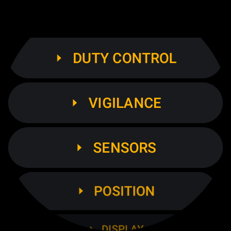 | 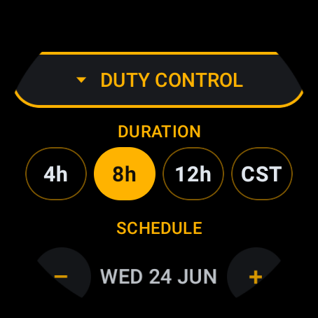 | 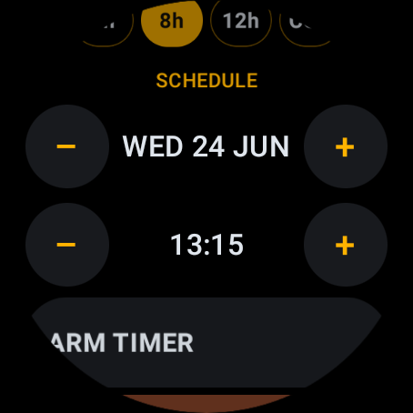 | 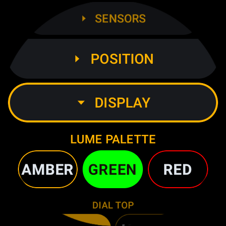 | 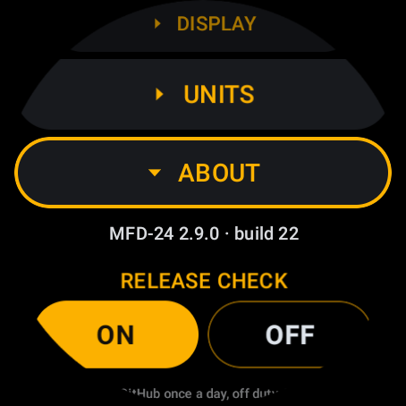 |

- **Duty control** — duration `4h` `8h` `12h` `CST`, a booked start, and one chip reading
  `START NOW` or a terracotta `END DUTY`. A start in the past cannot be booked.
- **Vigilance** — on/off, check interval, `VIBE STRENGTH`, `SOS SOUND` (OFF/LOW/MED/HIGH),
  `LOG PULSE`, and the incident log with its export.
- **Sensors** — what each hub slot reads.
- **Position** — automatic, or coordinates typed by hand.
- **Display** — palette, dial top, midnight mark, Nadir, sun and moon marks, weather, always-on,
  and `HINTS` for the small print under each row.
- **Units** — °C/°F, hPa/mmHg.
- **About** — version, the repository as a QR, the release check.

**[Every row, with the reasoning →](docs/DESIGN.md#settings)**

## The dial, in detail

| 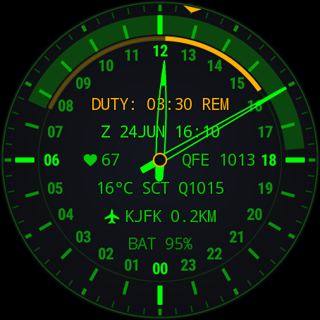 | 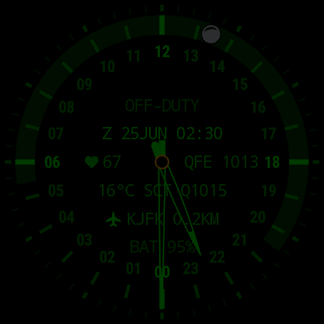 | 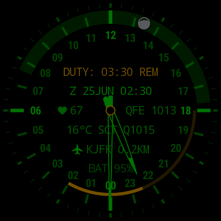 |
|---|---|---|
| Mid-watch: the arc is the shift, the bright part is what is left to serve. | `ALWAYS-ON > AUTO` thins the face after sunset — half the light, half the burn-in duty cycle. | A running watch keeps the full face all night: a night duty is exactly when the dial is read in the dark. |

**[How it works — layout, astronomy, the vigilance state machine, the tests →](docs/DESIGN.md)**

<details>
<summary><b>Footnotes — the pulse window, the step count, the hardware it needs, and what it weighs</b></summary>

<br>

<b id="pulse-window">The always-on pulse window.</b> With the screen off the heart-rate slot is not
left running: once a minute the face opens a fifteen-second window, lights the sensor, takes the
first plausible reading and puts the sensor out again. Three minutes without a lock and the figure
comes off the dial as dashes. Three empty windows in a row also slow the cadence to one window a
quarter of an hour, until a reading, a raised wrist or the wrist detector's own *worn* edge ends it
— because the detector can be wrong about a table, and was, for a whole night: six hundred windows
against the wood. Forty a night now, and nothing changes on a wrist, where a slot three minutes
without a lock is already showing dashes.

**How the step count is arrived at.** The row prefers the platform's own daily figure, through
Health Services, because that is the number the rest of the watch agrees with and it does not care
when this face was installed. Where a watch has no such provider, or the provider binds and then
says nothing, the face counts for itself from the hardware step counter. That fallback is exact
**from the next local midnight onward**, because the counter's value is recorded at the day
boundary; on the day you install it, it can only count from the moment you switch the slot on, and
it shows dashes rather than a `0` it would have invented. One watch tested here reports its "daily"
total as steps since the subscription began rather than since midnight — a provider quirk, not a
setting, and the reason the row is worth reading as *steps counted*, not as a fitness statistic.

**Screen.** Round, and tested at **454 × 454**. Every position on the dial is a fraction of the
radius, so other round sizes should be fine; square and chin-cut screens are not designed for and
will crop the outer scale. Text is sized from the radius too — the readout width budget is
arithmetic and there is a test that fails if a row would reach the hour numerals.

**Hardware and performance.** Wear OS 3.0+ (API 30), any watch the platform runs on; no GPU
features beyond an ordinary canvas. `render()` allocates nothing, so there is no garbage collector
pause to schedule around, and the frame rate is demand-driven: **one frame a second at rest**,
16 ms only while a transition is animating, and one frame a minute in always-on. The optional
sensors are the only real cost — heart rate is an LED, and the vigilance monitor keeps the
accelerometer batching in the sensor hub rather than waking the processor. Everything else runs off
cached values.

**Size.** About **3.5 MB** installed, of which roughly 2.8 MB is code, 190 KB the on-device site
index and 220 KB the picker preview. The index is stored uncompressed on purpose so it can be read
without unpacking. Six locales — English, German, French, Italian, Japanese, Chinese — for the
app's own strings; the other eighty locales of library strings, which it could never display,
cost 260 KB and are left out.

</details>

## What it is not

A personal instrument, not a certified one. The vigilance monitor is an uncertified aid: it can be
switched off, suspended by a loose strap, or delayed by the platform's own doze limits. The incident
log covers **one watch** — starting another empties it, so anything worth keeping leaves via
`EXPORT LOG` first. Nothing here substitutes for a device a regulator has approved.

<details>
<summary><b id="export">Exporting the incident log — two channels, and their limits</b></summary>

<br>

`EXPORT LOG`, in the vigilance section, puts the log on the two channels a watch actually has: a
**QR code** for the phone camera already pointed at it, and **sound** — Bell 202 AFSK, 1200 Bd,
8N1, the physical layer APRS uses, so the receiving end is `minimodem --rx 1200` held to the case.
Both carry the same plain-text packet: a header, the instrument's callsign, a `WATCH` line with the
shift's start, end and length, one incident per line in Zulu time — with `HR` and `BASE … AT` when
`LOG PULSE` is on — and an `END` line carrying the count and a CRC32 of everything above it, so a
blurred photograph or a noisy recording fails loudly rather than quietly losing a line.

- **The log holds the newest 32 incidents of the current watch**, for 30 days at most. Starting the
  next watch empties it; export first.
- **The sound always carries the whole log** — eighteen seconds of tones at the ceiling. The
  transmission starts when the screen opens and replays on a tap.
- **The QR carries the newest entries that fit** the largest code a 1.2-inch screen can show: all
  32 when the lines are bare instants, about 14 when every line carries a pulse and its reference.
  A truncated code says so — its `END` line reads `END 14 OF 32`, never `END 14`. For every line
  of a log that long, use the sound.
- **Read-only.** There is no import path, so nothing that reads a packet can write the record.
- **The callsign is derived, never entered.** `KILO-15` is a salted SHA-256 of the watch's own
  Android ID, mapped onto twenty prefixes × 99 numbers: the same watch gives the same callsign
  through every reinstall, a factory reset issues a new one, and the ID itself never leaves the
  watch. One of 1 980 names on a net, not a serial number — the packet carries nothing finer.
- **No minimodem?** [`tools/afsk/decode_afsk.py`](tools/afsk/decode_afsk.py) `recording.m4a` is the same receiver in one Python
  file: it takes any recording a phone makes, prints the packet and checks the CRC. On Windows,
  [`tools/afsk/AfskListener`](tools/afsk/AfskListener) ([`AfskListener.exe`](tools/afsk/AfskListener.exe), .NET 8) is the same receiver as a one-button app: press *Listen*, hold the
  watch to the microphone, read the packet as it lands.

</details>

## Build

```
git clone https://github.com/amorroma1/mfd-24.git
cd mfd-24
./gradlew :app:assembleEarthDebug
```

JDK 17+ and the Android SDK. 193 JVM tests: `./gradlew :app:testEarthDebugUnitTest`.

## How it was built

Designed, decided and worn by one person, written with Claude (Anthropic) as a pair-programmer.
Every constant that could be measured was measured on the watch rather than reasoned about, every
invariant is pinned by a test, and nothing ships that has not run on the wrist. The working notes
in `CLAUDE.md` are the record of that collaboration and stay in the repository on purpose.

## Licence

GPL-3.0-or-later — see [LICENSE](LICENSE). Naval bases and heliports are derived from OpenStreetMap
(© OpenStreetMap contributors, **ODbL**), so any index built from them carries that licence too;
airports, ports and spaceports are curated in this repository. Weather from
[Open-Meteo](https://open-meteo.com/) (CC BY 4.0) and
[aviationweather.gov](https://aviationweather.gov/) (US NOAA, public domain).
