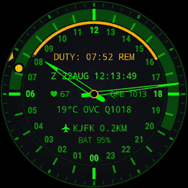

# MFD-24

*Multi-Function Display, 24 heures : l'écran du cockpit, et la journée en un tour d'aiguille des heures.*

[](https://github.com/amorroma1/mfd-24/actions/workflows/build.yml)

[English](../../README.md) · **Français** · [Deutsch](README.de.md) · [Italiano](README.it.md) · [日本語](README.ja.md) · [中文](README.zh.md)

Un cadran d'instrument 24 heures pour ceux qui prennent le quart — pilotes, marins, opérateurs de
drones, officiers de permanence. Un tour d'aiguille des heures par jour, votre quart dessiné comme
un arc de ce jour, un moniteur « homme mort » qui escalade en SOS et laisse une trace, et la
télémétrie dont un quart a réellement besoin.

Tout fonctionne hors ligne, sauf la météo. Pas d'application compagnon, pas de compte, pas de
télémétrie vers qui que ce soit. GPL.

| Interactif | Veille active |
|---|---|
|  |  |

*Un quart en cours à New York JFK. Le même cadran sur les deux images : la veille active est le
cadran interactif, atténué, sans le curseur des secondes ni le lavis de fond.*

**Wear OS 3.0+ (API 30).** Conçu et porté sur une TicWatch Pro 3 Ultra (454 × 454).
**[Installer →](INSTALL.fr.md)**

---

## L'essentiel

| | |
|---|---|
| **Cadran 24 h** | Un tour par jour. Midi en haut ou minuit en haut. Les minutes sur leur propre anneau ; la seconde est un curseur qui saute de graduation en graduation, rien ne balaie. |
| **Minuteur de quart** | Démarrage immédiat ou programmé. Un arc couvre les heures de service et s'atténue à mesure qu'elles sont servies ; `DUTY: 04:40 REM` fait le compte à rebours. Les deux bornes sonnent et vibrent, même écran éteint. Un quart terminé s'efface de lui-même une heure plus tard. |
| **Moniteur de vigilance** | Désactivé par défaut. Toutes les 5/10/15 min il demande un signe de vie ; trente secondes plus tard il sonne le SOS en salves et laisse `MAN DOWN` avec l'instant Zulu sur le cadran. En option : votre pouls pendant le contrôle manqué, comparé au dernier relevé que le cadran avait pris avant. |
| **Zulu + groupe date-heure** | `Z 22AUG 12:16`, l'heure dans laquelle s'écrit une entrée de journal. |
| **Météo** | Température, conditions en abrégés METAR et QNH. Sur un aérodrome, c'est le **METAR du terrain lui-même** ; partout ailleurs, Open-Meteo. Rafraîchie toutes les 30 minutes. |
| **Verrouillage de site à 5 km** | Nomme l'aérodrome, le port, l'héliport ou la base de lancement le plus proche parmi 9 649 sites d'un index embarqué de 194 Ko. Les sites militaires sont dessinés en couleur d'accent. |
| **Nadir, soleil et lune** | Les heures de jour ombrées sur l'anneau des heures, calculées hors ligne. Le soleil et la lune sont à leur véritable angle horaire — pointez une marque vers l'astre lui-même et le cadran devient une **boussole**. La lune porte sa phase réelle. |
| **Emplacements capteurs** | Deux affichages optionnels de part et d'autre du moyeu : fréquence cardiaque, total de pas du jour fourni par la plateforme, ou pression de station. Désactivés par défaut ; ils ne tournent qu'écran allumé. En veille active, le pouls est relu une fois par minute tant que la montre est portée — une fenêtre de quinze secondes, des tirets après trois minutes sans verrouillage. |
| **Veille active** | Le même cadran, atténué. `AUTO` le réduit à un pixel sur deux après le coucher du soleil — jamais pendant un quart de nuit. |
| **Démarrage direct** | S'affiche déjà rempli avant que la montre soit déverrouillée. |

## En action

| Un contrôle manqué, acquitté tard | Changement de fuseau | Réveil |
|---|---|---|
|  |  |  |
| Le SOS est resté sans réponse : `MAN DOWN`, l'instant Zulu, une marque sur l'arc. Un toucher répond par `TAP AGAIN` ; un second, dans la seconde, l'efface — une manche de veste ne le peut pas. | L'échelle des heures glisse par le chemin le plus court autour du jour ; l'aiguille des minutes ne prend que ce qui reste dans l'heure. Le temps de quart restant ne change jamais. | Seule la lumière arrive. La veille active porte les mêmes teintes, il n'y a donc rien à fondre. |

## Installation

Téléchargez `app-earth-release.apk` depuis la
[dernière version](https://github.com/amorroma1/mfd-24/releases/latest) et installez-le en
sideload. Wear OS n'a pas d'interface de sideloading, c'est donc un travail pour ADB :

```
adb connect 192.168.1.50:41234
adb install -r app-earth-release.apk
```

Puis choisissez MFD-24 dans le sélecteur de cadrans de la montre.
**[Guide complet — trois routes, de « un téléphone et rien d'autre » à la compilation depuis le source →](INSTALL.fr.md)**

<details>
<summary><b>Les mises à jour, et pourquoi ce n'est pas sur Google Play</b></summary>

<br>

La montre interroge GitHub **une fois par jour, hors quart**, et vous prévient une fois par
version. Elle ne télécharge rien et n'installe rien : **Wear OS ne laisse pas une application en
installer une autre** (vérifié sur une TicWatch Pro 3 Ultra). `ABOUT → RELEASES` affiche la page
de la version en QR code pour l'appareil photo d'un téléphone, et l'installation reste
`adb install -r`. `ABOUT → RELEASE CHECK` désactive tout.

Il n'est pas sur Google Play à dessein : un moniteur « homme mort » ne doit pas être une
installation impulsive, les permissions dont il a légitimement besoin maintiendraient un projet de
loisir en révision permanente par le magasin, et un APK avec son SHA-256 dans les notes de version
se vérifie mieux qu'une fiche. Le raisonnement complet est dans
[INSTALL.fr.md](INSTALL.fr.md#pourquoi-mfd-24-nest-pas-sur-google-play).

</details>

<details>
<summary><b id="permissions">Permissions — rien n'est demandé à l'installation</b></summary>

<br>

La localisation est demandée depuis l'écran des réglages, parce qu'un cadran est un
`WallpaperService` et ne peut pas ouvrir de dialogue lui-même.

| Permission | Pour | Sans elle |
|---|---|---|
| `ACCESS_FINE_LOCATION` | la météo, le Nadir, le verrouillage de site | ces trois-là restent vides ; l'horloge et l'astronomie ne sont pas touchées |
| `ACCESS_BACKGROUND_LOCATION` | les mêmes, depuis la tâche de rafraîchissement de 30 minutes | la plateforme renvoie null plutôt qu'une erreur, ce qui ressemble exactement à une absence de signal |
| `WAKE_LOCK`, `FOREGROUND_SERVICE_HEALTH` | le moniteur de vigilance, qui doit continuer à mesurer écran éteint | cette fonction seulement |
| `VIBRATE` | les bornes du quart et le SOS | des bornes silencieuses |
| `SCHEDULE_EXACT_ALARM` | des bornes qui tombent à la minute | demandée mais **pas** requise ; sans elle, une borne peut glisser de quelques minutes |
| `INTERNET` | Open-Meteo et METAR toutes les 30 min, plus le contrôle quotidien des versions | pas de météo, pas de contrôle des versions |
| `BODY_SENSORS` | l'emplacement fréquence cardiaque et le pouls dans un incident | des tirets ; la ligne `LOG PULSE` n'est pas proposée |
| `ACTIVITY_RECOGNITION` | l'emplacement pas ; sur Wear 5+, aussi ce qui permet au service de vigilance de démarrer | des tirets ; sur les Wear récents, pas de vigilance |
| `POST_NOTIFICATIONS` | la notification permanente du moniteur, et l'avis de nouvelle version, une fois par version | le moniteur tourne sans s'annoncer |

Pas de contacts, pas de stockage, et aucun réseau au-delà de ces appels. Une position saisie à la
main remplace entièrement la localisation — voir **Position** dans les réglages.

</details>

## Réglages

**Appui long sur le cadran, puis touchez le crayon.** Sept sections repliables, une seule ouverte
à la fois ; celle qui est ouverte est encadrée.

| Sections | Contrôle du quart | Programmation | Affichage | À propos |
|---|---|---|---|---|
|  |  |  |  |  |

- **Contrôle du quart** — durée `4h` `8h` `12h` `CST`, un début programmé, et une seule puce qui
  lit `START NOW` ou un `END DUTY` terre cuite. Un début dans le passé ne peut pas être programmé.
- **Vigilance** — marche/arrêt, intervalle de contrôle, `VIBE STRENGTH`, `SOS SOUND`
  (OFF/LOW/MED/HIGH), `LOG PULSE`, et le journal d'incidents avec son export.
- **Capteurs** — ce que lit chaque emplacement du moyeu.
- **Position** — automatique, ou des coordonnées saisies à la main.
- **Affichage** — palette, haut du cadran, marque de minuit, Nadir, marques solaire et lunaire,
  météo, veille active, et `HINTS` pour les petits caractères sous chaque ligne.
- **Unités** — °C/°F, hPa/mmHg.
- **À propos** — version, le dépôt en QR code, le contrôle des versions.

**[Chaque ligne, avec le raisonnement (en anglais) →](../DESIGN.md#settings)**

## Le cadran, en détail

|  |  |  |
|---|---|---|
| En plein quart : l'arc est le quart, la partie vive est ce qui reste à servir. | `ALWAYS-ON > AUTO` allège le cadran après le coucher du soleil — moitié moins de lumière, moitié moins de temps d'exposition au marquage. | Un quart en cours garde le cadran complet toute la nuit : un quart de nuit est précisément le moment où le cadran se lit dans le noir. |

**[Comment ça marche — disposition, astronomie, la machine à états de la vigilance, les tests (en anglais) →](../DESIGN.md)**

<details>
<summary><b>Notes — le compte de pas, le matériel requis, et ce que ça pèse</b></summary>

<br>

**D'où vient le compte de pas.** La ligne préfère le total du jour fourni par la plateforme
elle-même, via Health Services, parce que c'est le chiffre sur lequel le reste de la montre
s'accorde et qu'il ne dépend pas de la date d'installation de ce cadran. Quand une montre n'a
pas ce fournisseur, ou que le fournisseur se connecte puis ne dit rien, le cadran compte lui-même à
partir du compteur de pas matériel. Ce repli est exact **à partir du minuit local suivant**, parce
que la valeur du compteur est relevée à la frontière du jour ; le jour de l'installation, il ne
peut compter qu'à partir du moment où vous activez l'emplacement, et il affiche des tirets plutôt
qu'un `0` qu'il aurait inventé. Une montre testée ici rapporte son total « du jour » comme les pas
depuis le début de l'abonnement plutôt que depuis minuit — une particularité du fournisseur, pas
un réglage, et la raison pour laquelle la ligne se lit comme *des pas comptés*, pas comme une
statistique de forme.

**Écran.** Rond, et testé en **454 × 454**. Chaque position du cadran est une fraction du rayon,
les autres tailles rondes devraient donc convenir ; les écrans carrés ou tronqués en bas ne sont
pas prévus et rogneront l'échelle extérieure. Le texte est lui aussi dimensionné d'après le rayon —
le budget de largeur des affichages est de l'arithmétique, et un test échoue si une ligne devait
atteindre les chiffres des heures.

**Matériel et performances.** Wear OS 3.0+ (API 30), toute montre où la plateforme tourne ;
aucune fonction GPU au-delà d'un canvas ordinaire. `render()` n'alloue rien, il n'y a donc aucune
pause du ramasse-miettes à contourner, et la cadence d'images suit la demande : **une image par
seconde au repos**, 16 ms seulement pendant qu'une transition s'anime, et une image par minute en
veille active. Les capteurs optionnels sont le seul coût réel — la fréquence cardiaque est une
LED, et le moniteur de vigilance laisse l'accéléromètre accumuler ses lots dans le hub de capteurs
plutôt que de réveiller le processeur. Tout le reste tourne sur des valeurs en cache.

**Taille.** Environ **3,5 Mo** installé, dont à peu près 2,8 Mo de code, 190 Ko pour l'index de
sites embarqué et 220 Ko pour l'aperçu du sélecteur. L'index est stocké non compressé à dessein,
pour être lu sans décompression. Ressources en anglais seulement : le texte de l'application
est en anglais, et embarquer quatre-vingts locales de chaînes de bibliothèque qu'elle ne peut
jamais afficher coûtait 260 Ko.

</details>

## Ce qu'il n'est pas

Un instrument personnel, pas un instrument certifié. Le moniteur de vigilance est une aide non
certifiée : il peut être désactivé, suspendu par un bracelet lâche, ou retardé par les limites de
sommeil (Doze) de la plateforme elle-même. Le journal d'incidents couvre **un seul quart** — en
commencer un autre le vide, donc tout ce qui vaut d'être gardé en sort d'abord par `EXPORT LOG`.
Rien ici ne remplace un appareil approuvé par un régulateur.

<details>
<summary><b>Exporter le journal d'incidents — deux canaux, et leurs limites</b></summary>

`EXPORT LOG`, dans la section vigilance, met le journal sur les deux canaux qu'une montre possède
vraiment : un **QR code** pour l'appareil photo du téléphone déjà pointé dessus, et le **son** —
Bell 202 AFSK, 1200 Bd, 8N1, la couche physique qu'utilise l'APRS, de sorte que l'autre bout est
`minimodem --rx 1200` tenu contre le boîtier. Les deux portent le même paquet en texte brut : un
en-tête, l'indicatif de l'instrument, une ligne `WATCH` avec le début, la fin et la durée du
quart, un incident par ligne en heure Zulu — avec `HR` et `BASE … AT` quand `LOG PULSE` est
activé — et une ligne `END` portant le compte et un CRC32 de tout ce qui précède, pour qu'une
photo floue ou un enregistrement bruité échoue bruyamment plutôt que de perdre une ligne en
silence.

- **Le journal garde les 32 incidents les plus récents du quart en cours**, 30 jours au plus.
  Commencer le quart suivant le vide ; exportez d'abord.
- **Le son porte toujours tout le journal** — dix-huit secondes de tonalités au plafond. La
  transmission démarre à l'ouverture de l'écran et se rejoue d'un toucher.
- **Le QR porte les entrées les plus récentes qui tiennent** dans le plus grand code qu'un écran
  de 1,2 pouce peut afficher : les 32 quand les lignes sont de simples instants, environ 14 quand
  chaque ligne porte un pouls et sa référence. Un code tronqué le dit — sa ligne `END` lit
  `END 14 OF 32`, jamais `END 14`. Pour chaque ligne d'un journal aussi long, utilisez le son.
- **Lecture seule.** Il n'y a pas de chemin d'import, donc rien de ce qui lit un paquet ne peut
  écrire l'enregistrement.

</details>

## Compilation

```
git clone https://github.com/amorroma1/mfd-24.git
cd mfd-24
./gradlew :app:assembleEarthDebug
```

JDK 17+ et le SDK Android. 192 tests JVM : `./gradlew :app:testEarthDebugUnitTest`.

## Comment il a été construit

Conçu, décidé et porté par une seule personne, écrit avec Claude (Anthropic) en binôme de
programmation. Chaque constante qui pouvait être mesurée l'a été sur la montre plutôt que déduite,
chaque invariant est fixé par un test, et rien n'est publié qui n'ait tourné au poignet. Les notes
de travail dans `CLAUDE.md` sont la trace de cette collaboration et restent dans le dépôt à dessein.

## Licence

GPL-3.0-or-later — voir [LICENSE](../../LICENSE). Les bases navales et les héliports
proviennent d'OpenStreetMap (© contributeurs OpenStreetMap, **ODbL**), donc tout index construit
à partir d'eux porte aussi cette licence ; aérodromes, ports et bases de lancement sont tenus à
jour dans ce dépôt. Météo de [Open-Meteo](https://open-meteo.com/) (CC BY 4.0) et
[aviationweather.gov](https://aviationweather.gov/) (NOAA américaine, domaine public).
