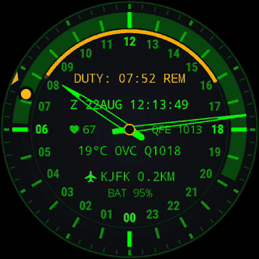

# MFD-24

*Multi-Function Display, 24 ore: lo schermo del cockpit, e la giornata in un giro della lancetta delle ore.*

[](https://github.com/amorroma1/mfd-24/actions/workflows/build.yml)

[English](../../README.md) · [Français](README.fr.md) · [Deutsch](README.de.md) · **Italiano** · [日本語](README.ja.md) · [中文](README.zh.md)

Un quadrante strumentale a 24 ore per chi monta di guardia — piloti, naviganti, equipaggi di
droni, ufficiali di servizio. Un giro della lancetta delle ore al giorno, il proprio turno
disegnato come un arco di quel giorno, un monitor «uomo morto» che passa all'SOS e lascia una
registrazione, e la telemetria di cui un turno di guardia vive davvero.

Tutto funziona offline tranne il meteo. Nessuna app companion, nessun account, nessuna analitica.
GPL.

| Interattivo | Always-on |
|---|---|
|  |  |

*Un turno in corso a New York JFK. Lo stesso quadrante in entrambe le immagini: l'always-on è il
quadrante interattivo, attenuato, senza il cursore dei secondi e senza il velo di fondo.*

**Wear OS 3.0+ (API 30).** Costruito e indossato su un TicWatch Pro 3 Ultra (454 × 454).
**[Installare →](INSTALL.it.md)**

---

## Cosa si ottiene

| | |
|---|---|
| **Quadrante 24 h** | Un giro al giorno. Mezzogiorno in alto o mezzanotte in alto. I minuti su un anello proprio; il secondo è un cursore che scatta, così nulla spazza il quadrante. |
| **Timer di turno** | Avvio immediato o prenotato. Un arco copre le ore di servizio e si attenua mentre vengono servite; `DUTY: 04:40 REM` conta alla rovescia. Entrambi i confini suonano e vibrano a schermo spento. Un turno concluso si cancella da sé un'ora dopo. |
| **Monitor di vigilanza** | Spento per impostazione predefinita. Ogni 5/10/15 min vuole un segno di vita; trenta secondi dopo suona l'SOS a raffiche e lascia `MAN DOWN` con l'istante Zulu sul quadrante. In opzione: il polso durante il controllo mancato, contro l'ultima lettura del quadrante stesso prima di esso. |
| **Zulu + gruppo data-orario** | `Z 22AUG 12:16`, l'ora in cui si scrive una voce di giornale. |
| **Meteo** | Temperatura, condizione in stile METAR e QNH. In un aeroporto è il **METAR proprio** di quel campo; ovunque altrove Open-Meteo. Aggiornato ogni 30 minuti. |
| **Aggancio sito a 5 km** | Nomina l'aeroporto, il porto, l'eliporto o la base di lancio più vicini fra 9 649 siti in un indice di bordo da 194 KB. I siti militari sono disegnati nel colore d'accento. |
| **Nadir, sole e luna** | Le ore di luce ombreggiate sull'anello delle ore, calcolate offline. Il sole e la luna stanno al loro vero angolo orario — puntate una marca verso l'astro stesso e il quadrante è una **bussola**. La luna porta la sua fase reale. |
| **Slot sensori** | Due letture opzionali accanto al mozzo: frequenza cardiaca, il totale giornaliero di passi della piattaforma stessa, o pressione di stazione. Spenti per impostazione predefinita; girano solo a schermo acceso. In always-on il polso viene riletto una volta al minuto finché l'orologio è indossato — una finestra di quindici secondi, trattini dopo tre minuti senza aggancio. |
| **Always-on** | Lo stesso quadrante, attenuato. `AUTO` lo riduce a un pixel su due dopo il tramonto — mai durante un turno di notte. |
| **Direct boot** | Si disegna già popolato prima che l'orologio venga sbloccato. |

## In azione

| Un controllo mancato, riconosciuto tardi | Attraversando i fusi orari | Il risveglio |
|---|---|---|
|  |  |  |
| L'SOS è rimasto senza risposta: `MAN DOWN`, l'istante Zulu, un segno sull'arco. Un tocco risponde con `TAP AGAIN`; un secondo, entro un secondo, lo cancella — una manica non può. | La scala delle ore scivola per la via più breve intorno al giorno; la lancetta dei minuti prende solo ciò che resta dentro l'ora. Il tempo di servizio rimanente non cambia mai. | Arriva solo la luce. L'always-on veste le stesse tinte, così non c'è nulla da dissolvere. |

## Installazione

Scaricare `app-earth-release.apk` dall'
[ultima release](https://github.com/amorroma1/mfd-24/releases/latest) e installarlo via sideload.
Wear OS non ha un'interfaccia di sideloading, quindi è un lavoro per ADB:

```
adb connect 192.168.1.50:41234
adb install -r app-earth-release.apk
```

Poi scegliere MFD-24 nel selettore di quadranti dell'orologio.
**[Guida completa — tre percorsi, da « solo un telefono » alla compilazione dal sorgente →](INSTALL.it.md)**

<details>
<summary><b>Aggiornamenti, e perché non è su Google Play</b></summary>

<br>

L'orologio interroga GitHub **una volta al giorno, fuori turno**, e lo dice una volta per release.
Non scarica nulla e non installa nulla: **Wear OS non permette a un'app di installare un'app**
(verificato su un TicWatch Pro 3 Ultra). `ABOUT → RELEASES` mostra la pagina della release come
codice QR per la fotocamera di un telefono, e l'installazione resta `adb install -r`.
`ABOUT → RELEASE CHECK` spegne tutto quanto.

Non è su Google Play di proposito: un monitor «uomo morto» non deve essere un'installazione
d'impulso, i permessi di cui ha legittimamente bisogno terrebbero un progetto amatoriale in
revisione permanente dello store, e un APK con il suo SHA-256 nelle note di release è più
verificabile di una scheda. Il ragionamento completo in
[INSTALL.it.md](INSTALL.it.md#perché-mfd-24-non-è-su-google-play).

</details>

<details>
<summary><b id="permissions">Permessi — all'installazione non viene chiesto nulla</b></summary>

<br>

La posizione viene chiesta dalla schermata delle impostazioni, perché un quadrante è un
`WallpaperService` e non può aprire un dialogo da sé.

| Permesso | Per | Senza |
|---|---|---|
| `ACCESS_FINE_LOCATION` | meteo, Nadir, l'aggancio del sito | quei tre restano vuoti; l'orologio e l'astronomia non ne risentono |
| `ACCESS_BACKGROUND_LOCATION` | gli stessi, dal job di aggiornamento ogni 30 minuti | la piattaforma restituisce null anziché un errore, che è identico all'assenza di segnale |
| `WAKE_LOCK`, `FOREGROUND_SERVICE_HEALTH` | il monitor di vigilanza, che deve continuare a sentire a schermo spento | solo quella funzione |
| `VIBRATE` | i confini del turno e l'SOS | confini silenziosi |
| `SCHEDULE_EXACT_ALARM` | confini che cadono sul minuto | richiesto ma **non** necessario; senza, un confine può slittare di qualche minuto |
| `INTERNET` | Open-Meteo e METAR ogni 30 min, più il controllo quotidiano delle release | niente meteo, niente controllo delle release |
| `BODY_SENSORS` | lo slot della frequenza cardiaca e il polso in un incidente | trattini; la riga `LOG PULSE` non viene offerta |
| `ACTIVITY_RECOGNITION` | lo slot dei passi; su Wear 5+ anche ciò che permette al servizio di vigilanza di avviarsi | trattini; sui Wear più recenti, niente vigilanza |
| `POST_NOTIFICATIONS` | l'avviso persistente del monitor, e l'avviso di aggiornamento una volta per release | il monitor gira senza annunciarsi |

Nessun contatto, nessuna memoria, nessuna rete oltre quelle chiamate. Una posizione digitata a
mano sostituisce del tutto la localizzazione — vedere **Posizione** nelle impostazioni.

</details>

## Impostazioni

**Pressione lunga sul quadrante, poi un tocco sulla matita.** Sette sezioni a scomparsa, una
aperta alla volta; quella aperta è contornata.

| Sezioni | Controllo turno | Programmazione | Display | About |
|---|---|---|---|---|
|  |  |  |  |  |

- **Controllo turno** — durata `4h` `8h` `12h` `CST`, un avvio prenotato, e un chip che legge
  `START NOW` oppure un `END DUTY` terracotta. Un avvio nel passato non si può prenotare.
- **Vigilanza** — on/off, intervallo di controllo, `VIBE STRENGTH`, `SOS SOUND` (OFF/LOW/MED/HIGH),
  `LOG PULSE`, e il registro degli incidenti con la sua esportazione.
- **Sensori** — cosa legge ciascuno slot del mozzo.
- **Posizione** — automatica, o coordinate digitate a mano.
- **Display** — tavolozza, cima del quadrante, marca di mezzanotte, Nadir, marche di sole e luna,
  meteo, always-on, e `HINTS` per le note in piccolo sotto ogni riga.
- **Unità** — °C/°F, hPa/mmHg.
- **About** — versione, il repository come QR, il controllo delle release.

**[Ogni riga, con il ragionamento →](../DESIGN.md#settings)**

## Il quadrante, nel dettaglio

|  |  |  |
|---|---|---|
| A metà turno: l'arco è il turno, la parte luminosa è ciò che resta da servire. | `ALWAYS-ON > AUTO` dirada il quadrante dopo il tramonto — metà della luce, metà del ciclo di burn-in. | Un turno in corso tiene il quadrante pieno tutta la notte: un turno notturno è esattamente quando il quadrante si legge al buio. |

**[Come funziona — layout, astronomia, la macchina a stati della vigilanza, i test →](../DESIGN.md)**

<details>
<summary><b>Note — il conteggio dei passi, l'hardware necessario, e quanto pesa</b></summary>

<br>

**Come si arriva al conteggio dei passi.** La riga preferisce la cifra giornaliera della
piattaforma stessa, tramite Health Services, perché è il numero con cui il resto dell'orologio
concorda e non le importa quando questo quadrante è stato installato. Dove un orologio non ha un
tale provider, o il provider si collega e poi non dice nulla, il quadrante conta da sé dal
contapassi hardware. Quel ripiego è esatto **dalla mezzanotte locale successiva in poi**, perché
il valore del contatore viene registrato al confine del giorno; il giorno dell'installazione può
contare solo dal momento in cui si accende lo slot, e mostra trattini anziché uno `0` che avrebbe
inventato. Un orologio provato qui riporta il suo totale «giornaliero» come passi dall'inizio della
sottoscrizione anziché da mezzanotte — una stranezza del provider, non un'impostazione, e la
ragione per cui la riga va letta come *passi contati*, non come una statistica di fitness.

**Schermo.** Rotondo, e provato a **454 × 454**. Ogni posizione sul quadrante è una frazione del
raggio, quindi altre misure rotonde dovrebbero andare bene; gli schermi quadrati e con il «mento»
non sono previsti e taglieranno la scala esterna. Anche il testo è dimensionato dal raggio — il
budget di larghezza delle letture è aritmetica, e c'è un test che fallisce se una riga arrivasse
a toccare i numerali delle ore.

**Hardware e prestazioni.** Wear OS 3.0+ (API 30), qualsiasi orologio su cui giri la piattaforma;
nessuna funzione GPU oltre un canvas ordinario. `render()` non alloca nulla, quindi non c'è alcuna
pausa del garbage collector da cui guardarsi, e il frame rate è a richiesta: **un fotogramma al
secondo a riposo**, 16 ms solo mentre una transizione è in animazione, e un fotogramma al minuto
in always-on. I sensori opzionali sono l'unico costo reale — la frequenza cardiaca è un LED, e il
monitor di vigilanza tiene l'accelerometro in batch nel sensor hub anziché svegliare il
processore. Tutto il resto gira su valori in cache.

**Dimensione.** Circa **3,5 MB** installati, di cui circa 2,8 MB di codice, 190 KB l'indice dei
siti di bordo e 220 KB l'anteprima per il selettore. L'indice è conservato non compresso di
proposito, così si legge senza decomprimerlo. Risorse solo in inglese: il testo dell'app stessa è
in inglese, e portarsi dietro ottanta locale di stringhe di libreria che non potrebbe mai mostrare
costava 260 KB.

</details>

## Cosa non è

Uno strumento personale, non certificato. Il monitor di vigilanza è un ausilio non certificato:
può essere spento, sospeso da un cinturino allentato, o ritardato dai limiti di doze della
piattaforma stessa. Il registro degli incidenti copre **un turno** — avviarne un altro lo svuota,
quindi ciò che vale la pena conservare esce prima via `EXPORT LOG`. Nulla qui sostituisce un
dispositivo approvato da un ente regolatore.

<details>
<summary><b>Esportare il registro degli incidenti — due canali, e i loro limiti</b></summary>

`EXPORT LOG`, nella sezione vigilanza, mette il registro sui due canali che un orologio ha
davvero: un **codice QR** per la fotocamera del telefono già puntata su di esso, e il **suono** —
Bell 202 AFSK, 1200 Bd, 8N1, lo strato fisico usato da APRS, così dall'altra parte basta
`minimodem --rx 1200` tenuto contro la cassa. Entrambi portano lo stesso pacchetto in testo
semplice: un'intestazione, il nominativo (callsign) dello strumento, una riga `WATCH` con inizio,
fine e durata del turno, un incidente per riga in ora Zulu — con `HR` e `BASE … AT` quando
`LOG PULSE` è attivo — e una riga `END` con il conteggio e un CRC32 di tutto ciò che sta sopra,
così una fotografia sfocata o una registrazione rumorosa fallisce rumorosamente invece di perdere
una riga in silenzio.

- **Il registro tiene i 32 incidenti più recenti del turno in corso**, per al massimo 30 giorni.
  Avviare il turno successivo lo svuota; esportare prima.
- **Il suono porta sempre tutto il registro** — diciotto secondi di toni al massimo. La
  trasmissione parte all'apertura della schermata e si ripete con un tocco.
- **Il QR porta le voci più recenti che entrano** nel codice più grande che uno schermo da
  1,2 pollici può mostrare: tutte e 32 quando le righe sono istanti nudi, circa 14 quando ogni
  riga porta un polso e il suo riferimento. Un codice troncato lo dice — la sua riga `END` legge
  `END 14 OF 32`, mai `END 14`. Per ogni riga di un registro così lungo, usare il suono.
- **Sola lettura.** Non esiste un percorso di importazione, quindi nulla che legga un pacchetto
  può scrivere la registrazione.

</details>

## Compilazione

```
git clone https://github.com/amorroma1/mfd-24.git
cd mfd-24
./gradlew :app:assembleEarthDebug
```

JDK 17+ e l'SDK Android. 192 test JVM: `./gradlew :app:testEarthDebugUnitTest`.

## Come è stato costruito

Progettato, deciso e indossato da una sola persona, scritto con Claude (Anthropic) come
pair-programmer. Ogni costante che si poteva misurare è stata misurata sull'orologio anziché
dedotta, ogni invariante è fissata da un test, e nulla viene pubblicato che non abbia girato al
polso. Le note di lavoro in `CLAUDE.md` sono la traccia di questa collaborazione e restano nel
repository di proposito.

## Licenza

GPL-3.0-or-later — vedere [LICENSE](../../LICENSE). Basi navali ed eliporti provengono da
OpenStreetMap (© contributori OpenStreetMap, **ODbL**), quindi qualsiasi indice costruito da essi
porta anche quella licenza; aeroporti, porti e basi di lancio sono curati in questo repository.
Meteo da [Open-Meteo](https://open-meteo.com/) (CC BY 4.0) e
[aviationweather.gov](https://aviationweather.gov/) (US NOAA, pubblico dominio).
