# MFD-24

*Multi-Function Display, 24 ore: lo schermo del cockpit, e la giornata in un giro della lancetta delle ore.*

[](https://github.com/amorroma1/mfd-24/actions/workflows/build.yml)

[English](../../README.md) · [Français](README.fr.md) · [Deutsch](README.de.md) · **Italiano** · [日本語](README.ja.md) · [中文](README.zh.md)

Un quadrante strumentale a 24 ore per chi monta di guardia — piloti, naviganti, equipaggi di
droni, ufficiali di guardia. Un giro della lancetta delle ore al giorno, la propria guardia
disegnata come un arco di quel giorno, un dispositivo uomo morto che passa all'SOS e lascia traccia nel
giornale di bordo, e la telemetria di cui una guardia vive davvero.

Tutto funziona offline, tranne il meteo e il controllo quotidiano delle release. Nessuna app
companion, nessun account, nessuna analitica. GPL-3.0.

| Interattivo | Always-on |
|---|---|
| 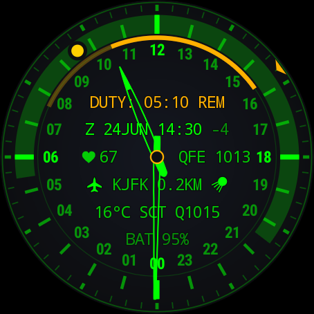 | 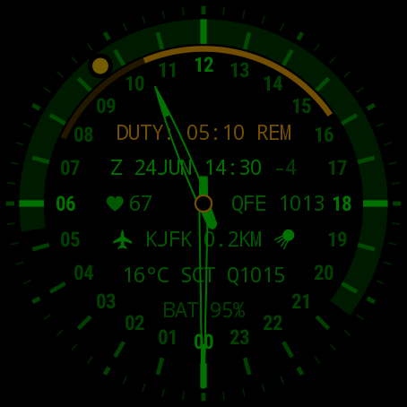 |

*Una guardia in corso a New York JFK. Lo stesso quadrante in entrambe le immagini: l'always-on è il
quadrante interattivo, attenuato, senza il cursore dei secondi e senza il velo di fondo.*

**Wear OS 3 e 4 (API 30–33).** Costruito e indossato su un TicWatch Pro 3 Ultra (Wear OS 3.5,
454 × 454); Wear OS 4 verificato solo sull'emulatore. **Wear OS 5 e successivi rifiutano i
quadranti di questo tipo** — vedi [Compatibilità](#compatibilità).
**[Installare →](INSTALL.it.md)**

*Non è un dispositivo medico né un sostituto di apparecchiature certificate. Fornito così com'è, sotto GPL.*

---

## Cosa si ottiene

| | |
|---|---|
| **Quadrante 24 h** | Un giro al giorno. Mezzogiorno in alto o mezzanotte in alto. I minuti su un anello proprio; il secondo è un cursore che scatta, così nulla spazza il quadrante. |
| **Timer di guardia** | Si monta subito o su prenotazione. Un arco copre le ore di guardia e si attenua mentre vengono servite; `DUTY: 04:40 REM` conta alla rovescia. Entrambi i confini suonano e vibrano a schermo spento. Una guardia smontata si cancella da sé un'ora dopo. |
| **Uomo morto** | Spento per impostazione predefinita. Ogni 5/10/15 min fa una richiesta da tacitare; trenta secondi dopo suona l'SOS a raffiche e lascia `MAN DOWN` — uomo a terra — con l'istante Zulu sul quadrante. In opzione annota il polso alla richiesta non tacitata, accanto all'ultima lettura in movimento. |
| **Esportazione del giornale** | Il giornale di bordo lascia l'orologio come **codice QR** per la fotocamera di un telefono o come **suono** — Bell 202 AFSK, decodificato da `minimodem`. Il suono porta tutto; il QR porta ciò che entra, e lo dice. [Canali e limiti ↓](#export) |
| **Zulu + gruppo data-orario** | `Z 11NOV 13:05 -5`, l'ora in cui si scrive una voce di giornale, seguita dallo scarto del quadrante. |
| **Meteo** | Temperatura, condizione in stile METAR e QNH. In un aeroporto è il **METAR proprio** di quel campo; ovunque altrove Open-Meteo. Aggiornato ogni 30 minuti. |
| **Aggancio sito a 5 km** | Nomina l'aeroporto, il porto, l'eliporto o la base di lancio più vicini fra 9 649 siti in un indice di bordo da 194 KB. I siti militari sono disegnati nel colore d'accento. |
| **Nadir, sole e luna** | L'arco diurno — le ore di luce ombreggiate sull'anello delle ore — calcolato offline. Il segno solare e il segno lunare stanno al vero angolo orario dell'astro — puntate un segno verso l'astro stesso e il quadrante è una **bussola** — anche a sud dell'equatore, dove i segni girano contro le lancette come il cielo. `ACTIVE SN` colora il meridiano di rosso a nord e di bianco a sud, a punta finché l'orologio sa il quadrante giusto entro 15°. La luna porta la sua fase reale. |
| **Slot sensori** | Due letture opzionali accanto al mozzo: frequenza cardiaca, i passi del giorno, o pressione di stazione. Spenti per impostazione predefinita; girano a schermo acceso, e in always-on il polso viene riletto una volta al minuto finché l'orologio è indossato. [Come quella finestra si regola ↓](#pulse-window) |
| **Always-on** | Lo stesso quadrante, attenuato. `AUTO` lo riduce a un pixel su due dopo il tramonto — mai durante una guardia di notte. |
| **Direct boot** | Si disegna già popolato prima che l'orologio venga sbloccato. |

## In azione

| Una richiesta mancata, tacitata tardi | Da JFK a Heathrow, tutto il volo | Il risveglio |
|---|---|---|
| 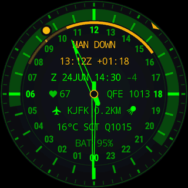 | 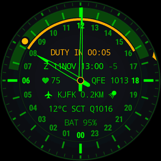 | 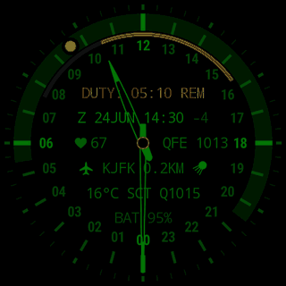 |
| L'SOS è rimasto senza risposta: `MAN DOWN`, l'istante Zulu, un segno sull'arco. Un tocco risponde con `TAP AGAIN`; un secondo, entro un secondo, lo cancella — una manica non può. | BA 178 dell'11 novembre 2026, l'orario reale, in 43 secondi, con `ORA LOCALE` su `LUOGO`: una guardia di otto ore montata al gate, il sito e il suo METAR spariti cinque minuti dopo la rotazione, la cabina a 790 hPa, le lancette che scivolano di fuso in fuso sotto l'aereo — −4 al largo della Nuova Scozia, −3:30 per un quarto d'ora sopra Terranova, 0 sopra l'Irlanda —, il tramonto sull'Atlantico, e `EGLL` di ritorno in finale corto. | Arriva solo la luce. L'always-on porta le stesse tinte, quindi non c'è nulla da dissolvere. |

*Il volo dura 43 secondi di proposito — una giornata intera per chi vuole vederne una; il suolo
va lento e l'oceano veloce.*

<details>
<summary><b>Due cose che la gente chiede sul volo</b></summary>

<br>

**Perché le lancette cambiano fuso sopra l'oceano?** Perché al quadrante è stato chiesto di
tenere l'ora del suolo sottostante: `ORA LOCALE` → `LUOGO`. Ogni cambio è l'orologio del luogo
sotto la rotta, non un'ipotesi sul viaggiatore — la mezz'ora di Terranova dura un quarto d'ora
perché tanto la rotta ci passa sopra, e lo scarto dopo lo Zulu dice quale orologio vale. Il fuso
segue la posizione: al polso cambia quando l'orologio scopre di nuovo dove si trova, e un confine
conta come attraversato solo tre chilometri dopo, così un punto che vaga lungo la linea non fa
oscillare le lancette. All'arrivo il quadrante è già sull'ora locale mentre il telefono cerca
ancora una rete. Lasciato su `TELEFONO`, il valore predefinito, il quadrante tiene il fuso del
telefono, che in volo cambia solo dopo l'atterraggio; sole e luna lasciano allora il quadrante per
la traversata invece di stare per ore fuori dall'arco diurno.

**Cosa c'è di vero?** L'orario è quello del BA 178 di quel giorno e le posizioni seguono la sua
rotta abituale sul Nord Atlantico, date al quadrante come punti GPS; l'astronomia è lavoro del
quadrante stesso a partire da quelli. Il meteo al gate è il METAR di KJFK di quella mattina, messo
nella cache del quadrante, perché nessun servizio fornisce un'osservazione passata. Polso, pressione di cabina e batteria sono messi
in scena sull'emulatore, perché un emulatore non ha un polso.

</details>

## Installazione

Scaricare `app-earth-release.apk` dall'
[ultima release](https://github.com/amorroma1/mfd-24/releases/latest) e installarlo via sideload.
Wear OS non ha un'interfaccia di sideloading, quindi è un lavoro per ADB:

```
adb connect 192.168.1.50:41234
adb install -r app-earth-release.apk
```

Poi scegliere MFD-24 nel selettore di quadranti dell'orologio. Niente computer? Un telefono può
eseguire la stessa stretta di mano ADB:
**[Wear Installer 2](https://play.google.com/store/apps/details?id=org.freepoc.wearinstaller2)**
o **[Bugjaeger](https://play.google.com/store/apps/details?id=eu.sisik.hackendebug)**, entrambi
di terzi, entrambi spiegati passo per passo nella guida.
**[Guida completa — tre percorsi, da « solo un telefono » alla compilazione dal sorgente →](INSTALL.it.md)**

<details>
<summary><b>Aggiornamenti, e perché non è su Google Play</b></summary>

<br>

L'orologio interroga GitHub **una volta al giorno, fuori guardia**, e lo dice una volta per release.
Non scarica nulla e non installa nulla: **Wear OS non permette a un'app di installare un'app**
(verificato su un TicWatch Pro 3 Ultra). `INFO → VERSIONI` mostra la pagina della release come
codice QR per la fotocamera di un telefono, e l'installazione resta `adb install -r`.
`INFO → AGGIORNAMENTI` spegne tutto quanto.

Non è su Google Play di proposito: un dispositivo uomo morto non deve essere un'installazione
d'impulso, i permessi di cui ha legittimamente bisogno terrebbero un progetto amatoriale in
revisione permanente dello store, e un APK con il suo SHA-256 nelle note di release è più
verificabile di una scheda. Il ragionamento completo in
[INSTALL.it.md](INSTALL.it.md#perché-mfd-24-non-è-su-google-play).

</details>

<details>
<summary><b id="permissions">Permessi — all'installazione non viene chiesto nulla</b></summary>

<br>

La posizione viene chiesta dalla schermata delle impostazioni, perché un quadrante è un
`WallpaperService` e non può aprire un dialogo da sé.

| Permesso | Per | Senza |
|---|---|---|
| `ACCESS_FINE_LOCATION` | meteo, Nadir, l'aggancio del sito | quei tre restano vuoti; l'orologio e l'astronomia non ne risentono |
| `ACCESS_BACKGROUND_LOCATION` | gli stessi, dal job di aggiornamento ogni 30 minuti | la piattaforma restituisce null anziché un errore, che è identico all'assenza di segnale |
| `WAKE_LOCK`, `FOREGROUND_SERVICE_HEALTH` | l'uomo morto, che deve continuare a sentire a schermo spento | solo quella funzione |
| `VIBRATE` | i confini della guardia e l'SOS | confini silenziosi |
| `SCHEDULE_EXACT_ALARM` | confini che cadono sul minuto | richiesto ma **non** necessario; senza, un confine può slittare di qualche minuto |
| `INTERNET` | Open-Meteo e METAR ogni 30 min, più il controllo quotidiano delle release | niente meteo, niente controllo delle release |
| `BODY_SENSORS` | lo slot della frequenza cardiaca e il polso in un evento | trattini; la riga `POLSO NEL GIORNALE` non viene offerta |
| `ACTIVITY_RECOGNITION` | lo slot dei passi; su Wear 5+ anche ciò che permette al servizio uomo morto di avviarsi | trattini; sui Wear più recenti, niente uomo morto |
| `POST_NOTIFICATIONS` | l'avviso persistente dell'uomo morto, e l'avviso di aggiornamento una volta per release | l'uomo morto gira senza annunciarsi |

Nessun contatto, nessuna memoria, nessuna rete oltre quelle chiamate. Un punto inserito a
mano sostituisce del tutto la localizzazione — vedere **Punto** nelle impostazioni.

</details>

## Compatibilità

| | |
|---|---|
| **Verificato al polso** | TicWatch Pro 3 Ultra GPS, Wear OS 3.5 (API 30) — l'orologio su cui è costruito e indossato |
| **Verificato sull'emulatore** | Wear OS 4 (API 33): si installa, disegna, l'editor si apre e una guardia prenotata avvia il suo servizio di vigilanza dallo sfondo |
| **Rifiutato dalla piattaforma** | Wear OS 5 e successivi (API 34+), sui dispositivi in cui il produttore non ha lasciato abilitati i quadranti di vecchio tipo |

MFD-24 è un quadrante AndroidX (Jetpack), e Google sta ritirando questo tipo: da gennaio 2026 il Play
Store accetta solo il Watch Face Format dichiarativo, e Wear OS 5 porta un interruttore,
`config_support_legacy_watch_faces`, impostato dal produttore. Sull'emulatore Wear OS 5 è spento: il
quadrante si installa, ma il sistema registra `Unsupported legacy watch face` e lo tiene fuori dal
selettore. Gli orologi usciti con Wear OS 5 dovrebbero comportarsi allo stesso modo; quelli
aggiornati da Wear OS 4 potrebbero tenere l'interruttore acceso. Segnalazioni in entrambi i sensi
sono benvenute nelle [Discussions](https://github.com/amorroma1/mfd-24/discussions).

Non c'è un porting da fare: il Watch Face Format è XML senza codice, e un uomo morto, una lettura
METAR o un punto su un sito non si possono scrivere lì. Dove questo quadrante gira, gira per intero.

## Impostazioni

**Pressione lunga sul quadrante, poi un tocco sulla matita.** Sette sezioni a scomparsa, una
aperta alla volta; quella aperta è contornata.

Le impostazioni seguono la lingua dell'orologio — inglese, tedesco, francese, italiano, giapponese o
cinese — nel vocabolario del servizio, non dell'app store: *Wache*, *quart*, *guardia*, 当直, 值更.
Il quadrante resta in inglese su ogni orologio: `DUTY`, `Z`, `QFE` e la riga METAR sono
nomenclatura da strumento, non prosa.

| Sezioni | Guardia | Turno | Display | Info |
|---|---|---|---|---|
| 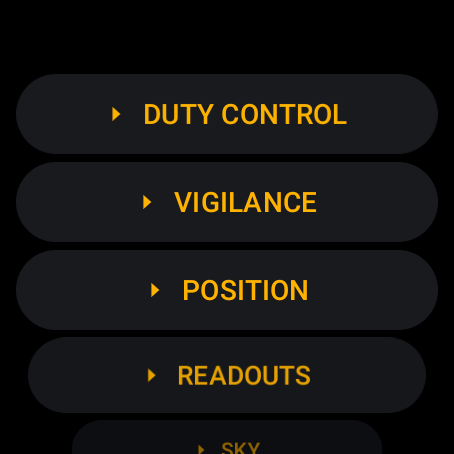 | 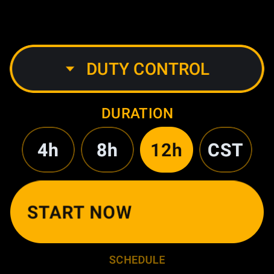 | 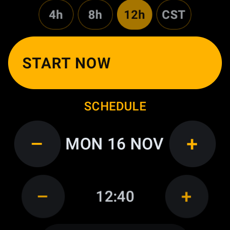 | 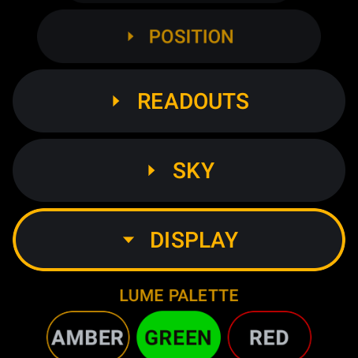 | 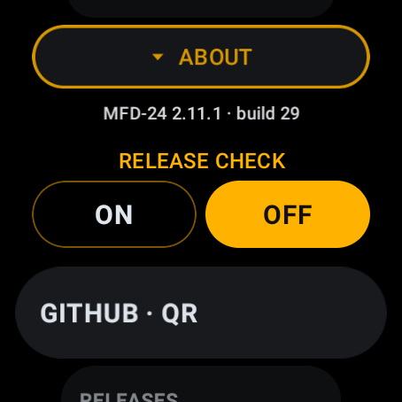 |

- **Guardia** — durata `4h` `8h` `12h` `PERS`, una guardia prenotata, e un chip che legge
  `MONTA DI GUARDIA` oppure, in terracotta, `SMONTA DI GUARDIA`. Non si può montare di guardia nel passato.
- **Uomo morto** — on/off, intervallo di richiesta, `VIBRAZIONE`, `SEGNALE SOS` (OFF/MIN/MED/MAX),
  `POLSO NEL GIORNALE`, e il giornale di bordo con la sua esportazione.
- **Sensori** — cosa legge ciascuno slot del mozzo.
- **Punto** — GPS, o coordinate inserite a mano. Un punto inserito mette il quadrante all'ora di
  quel luogo; un punto GPS può farlo anch'esso, con `ORA LOCALE` → `LUOGO`. Lo Zulu è seguito dallo
  scarto del quadrante (`Z 13NOV 13:58 -5`): quale orologio vale non è mai da indovinare. La riga
  della posizione, sopra il meteo, termina con uno spillo da mappa per un punto inserito, o con un satellite per un punto GPS: attenuato appena, in movimento, può essersi
  spostato di oltre 5 km, barrato dopo mezz'ora in movimento senza fix — l'ultima posizione resta
  comunque sul quadrante. `COORDINATE` la scrive dove comparirebbe `NO SITE`: `50°27N 30°31E`.
- **Display** — colore luminoso, alto del quadrante, segno di mezzanotte, Nadir, segno solare e lunare,
  `ACTIVE SN`, meteo, always-on, e `SUGGERIMENTI` per le note in piccolo sotto ogni riga.
- **Unità** — °C/°F, hPa/mmHg.
- **Info** — versione, il repository come QR, il controllo delle release.

**[Ogni riga, con il ragionamento →](../DESIGN.md#settings)**

## Il quadrante, nel dettaglio

| 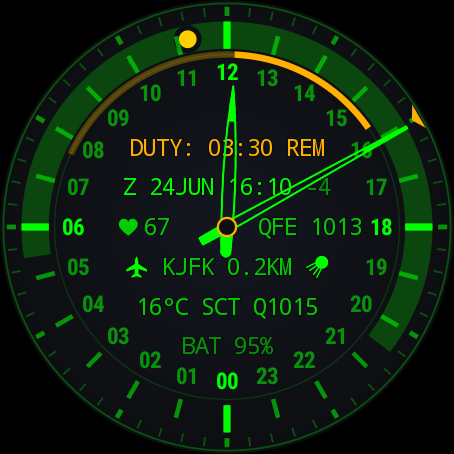 | 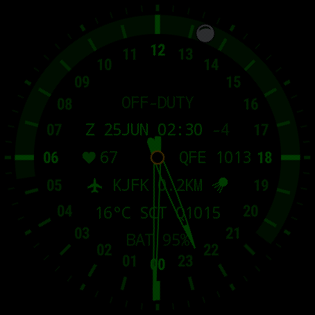 | 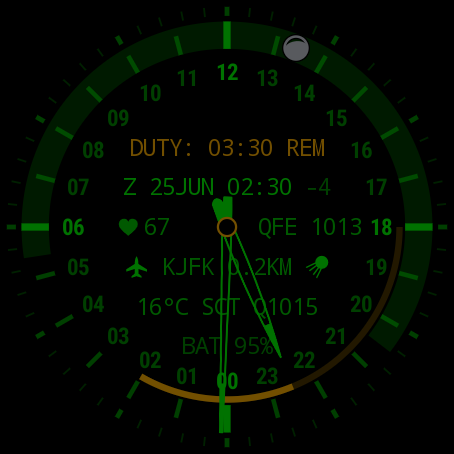 |
|---|---|---|
| A metà guardia: l'arco è la guardia, la parte luminosa è ciò che resta da servire. | `ALWAYS-ON > AUTO` dirada il quadrante dopo il tramonto — metà della luce, metà del ciclo di burn-in. | Una guardia in corso tiene il quadrante pieno tutta la notte: una guardia notturna è esattamente quando il quadrante si legge al buio. |

**[Come funziona — layout, astronomia, la macchina a stati dell'uomo morto, i test →](../DESIGN.md)**

<details>
<summary><b>Note — la finestra del polso, il conteggio dei passi, l'hardware necessario, e quanto pesa</b></summary>

<br>

<b id="pulse-window">La finestra del polso in always-on.</b> A schermo spento lo slot della
frequenza cardiaca non resta acceso: una volta al minuto il quadrante apre una finestra di quindici
secondi, accende il sensore, prende la prima lettura plausibile e lo spegne di nuovo. Tre minuti
senza aggancio e la cifra lascia il quadrante come trattini. Tre finestre vuote di fila rallentano
anche la cadenza a una finestra ogni quarto d'ora, finché una lettura, un polso sollevato o il
fronte *indossato* del rilevatore stesso non la chiudono: il rilevatore può scambiare un tavolo per *indossato*, e un tavolo non dà mai un
aggancio. Al polso non cambia nulla, dove uno slot da tre minuti senza aggancio mostra già
trattini.

**Come si arriva al conteggio dei passi.** La riga preferisce la cifra giornaliera della
piattaforma stessa, tramite Health Services, perché è il numero con cui il resto dell'orologio
concorda e non le importa quando questo quadrante è stato installato. Dove un orologio non ha un
tale provider, o il provider si collega e poi non dice nulla, il quadrante conta da sé dal
contapassi hardware. Quel ripiego è esatto **dalla mezzanotte locale successiva in poi**, perché
il valore del contatore viene registrato al confine del giorno; il giorno dell'installazione può
contare solo dal momento in cui si accende lo slot, e mostra trattini anziché uno `0` che avrebbe
inventato. Un orologio provato qui riporta il suo totale «giornaliero» come passi dall'inizio della
sottoscrizione anziché da mezzanotte — una stranezza del provider, non un'impostazione, e la
ragione per cui la riga va letta come *passi contati*, non come una statistica di fitness.

**Schermo.** Rotondo, e provato a **454 × 454**. Ogni posizione sul quadrante è una frazione del
raggio, quindi altre misure rotonde dovrebbero andare bene; gli schermi quadrati e con il «mento»
non sono previsti e taglieranno la scala esterna. Anche il testo è dimensionato dal raggio — il
budget di larghezza delle letture è aritmetica, e c'è un test che fallisce se una riga arrivasse
a toccare i numerali delle ore.

**Hardware e prestazioni.** Wear OS 3 o 4 (API 30–33), qualsiasi orologio rotondo su cui giri la
piattaforma — Wear OS 5 è l'eccezione, vedi [Compatibilità](#compatibilità);
nessuna funzione GPU oltre un canvas ordinario. `render()` non alloca nulla, quindi non c'è alcuna
pausa del garbage collector da cui guardarsi, e il frame rate è a richiesta: **un fotogramma al
secondo a riposo**, 16 ms solo mentre una transizione è in animazione, e un fotogramma al minuto
in always-on. I sensori opzionali sono l'unico costo reale — la frequenza cardiaca è un LED, e il
dispositivo uomo morto tiene l'accelerometro in batch nel sensor hub anziché svegliare il
processore. Tutto il resto gira su valori in cache.

**Dimensione.** Circa **3,5 MB** installati, di cui circa 2,8 MB di codice, 190 KB l'indice dei
siti di bordo e 220 KB l'anteprima per il selettore. L'indice è conservato non compresso di
proposito, così si legge senza decomprimerlo. Sei locale — inglese, tedesco, francese, italiano,
giapponese, cinese — per le stringhe dell'app; le altre ottanta locale di stringhe di libreria,
che non potrebbe mai mostrare, costavano 260 KB e restano fuori.

</details>

## Cosa non è

**MFD-24 non è un dispositivo medico, non è certificato come sostituto di alcun sistema hardware e
software certificato, ed è fornito così com'è, senza garanzia, sotto [GPL](../../LICENSE).**
Uno strumento personale, non certificato. L'uomo morto è un ausilio non certificato:
può essere spento, sospeso da un cinturino allentato, o ritardato dai limiti di doze della
piattaforma stessa. Il giornale di bordo copre **una guardia** — montarne un'altra lo svuota,
quindi ciò che vale la pena conservare esce prima via `GIORNALE · QR + ♪`. Nulla qui sostituisce un
dispositivo approvato da un ente regolatore.

<details>
<summary><b id="export">Esportare il giornale di bordo — due canali, e i loro limiti</b></summary>

<br>

`GIORNALE · QR + ♪`, nella sezione uomo morto, mette il giornale sui due canali che un orologio ha
davvero: un **codice QR** per la fotocamera del telefono già puntata su di esso, e il **suono** —
Bell 202 AFSK, 1200 Bd, 8N1, lo strato fisico usato da APRS, così dall'altra parte basta
`minimodem --rx 1200` tenuto contro la cassa. Entrambi portano lo stesso pacchetto in testo
semplice: un'intestazione, il nominativo (callsign) dello strumento, una riga `WATCH` con inizio,
fine e durata della guardia, un evento per riga in ora Zulu — con `HR` e `BASE … AT` quando
`POLSO NEL GIORNALE` è attivo — e una riga `END` con il conteggio e un CRC32 di tutto ciò che sta sopra,
così una fotografia sfocata o una registrazione rumorosa fallisce rumorosamente invece di perdere
una riga in silenzio.

- **Il giornale tiene i 32 eventi più recenti della guardia in corso**, per al massimo 30 giorni.
  Montare la guardia successiva lo svuota; esportare prima.
- **Il suono porta sempre tutto il giornale** — diciotto secondi di toni al massimo. La
  trasmissione parte all'apertura della schermata e si ripete con un tocco.
- **Il QR porta le voci più recenti che entrano** nel codice più grande che uno schermo da
  1,2 pollici può mostrare: tutte e 32 quando le righe sono istanti nudi, circa 14 quando ogni
  riga porta un polso e il suo riferimento. Un codice troncato lo dice — la sua riga `END` legge
  `END 14 OF 32`, mai `END 14`. Per ogni riga di un giornale così lungo, usare il suono.
- **Sola lettura.** Non esiste un percorso di importazione, quindi nulla che legga un pacchetto
  può scrivere il giornale.
- **Il nominativo è derivato, mai digitato.** `KILO-15` è uno SHA-256 salato dell'ID Android
  dell'orologio, proiettato su venti prefissi × 99 numeri: lo stesso orologio dà lo stesso
  nominativo a ogni reinstallazione, un ripristino di fabbrica ne assegna uno nuovo, e l'ID in sé
  non lascia mai l'orologio. Un nome fra 1 980 su una rete, non un numero di serie — il pacchetto
  non porta nulla di più fine.
- **Niente minimodem?** [`tools/afsk/decode_afsk.py`](../../tools/afsk/decode_afsk.py) `registrazione.m4a` è lo stesso ricevitore in
  un file Python: prende qualsiasi registrazione fatta col telefono, stampa il pacchetto e verifica
  il CRC. Su Windows, [`tools/afsk/AfskListener`](../../tools/afsk/AfskListener) ([`AfskListener.exe`](../../tools/afsk/AfskListener.exe), .NET 8) è lo stesso ricevitore come app a un pulsante:
  *Listen*, l'orologio al microfono, il pacchetto si legge mentre arriva.

</details>

## Compilazione

```
git clone https://github.com/amorroma1/mfd-24.git
cd mfd-24
./gradlew :app:assembleEarthDebug
```

JDK 17+ e l'SDK Android. 248 test JVM: `./gradlew :app:testEarthDebugUnitTest`.

## Come è stato costruito

Progettato, deciso e indossato da una sola persona, scritto con Claude (Anthropic) come
pair-programmer. Ogni costante che si poteva misurare è stata misurata sull'orologio anziché
dedotta, ogni invariante è fissata da un test, e nulla viene pubblicato che non abbia girato al
polso.

## Licenza

GPL-3.0-or-later — vedere [LICENSE](../../LICENSE). Basi navali ed eliporti provengono da
OpenStreetMap (© contributori OpenStreetMap, **ODbL**), quindi qualsiasi indice costruito da essi
porta anche quella licenza; i confini dei fusi orari vengono da [timezone-boundary-builder](https://github.com/evansiroky/timezone-boundary-builder), anch'essi
derivati da OpenStreetMap e **ODbL**; aeroporti, porti e basi di lancio sono curati in questo
repository.
Meteo da [Open-Meteo](https://open-meteo.com/) (CC BY 4.0) e
[aviationweather.gov](https://aviationweather.gov/) (US NOAA, pubblico dominio).
