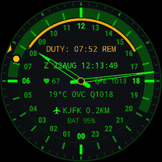

# MFD-24

*Multi-Function Display、24時間：コックピットの画面と、時針一周ぶんの一日。*

[](https://github.com/amorroma1/mfd-24/actions/workflows/build.yml)

[English](../../README.md) · [Français](README.fr.md) · [Deutsch](README.de.md) · [Italiano](README.it.md) · **日本語** · [中文](README.zh.md)

当直に立つ人のための24時間計器文字盤 — パイロット、船乗り、ドローン運用者、当直士官。時針は一日に一周。自分の当直はその一日の弧として描かれ、デッドマン・モニターはSOSへ段階的に移行して記録を残し、文字盤の残りには当直が実際に必要とするテレメトリが載っています。

気象を除いてすべてオフラインで動きます。コンパニオンアプリなし、アカウントなし、外部への計測データ送信なし。GPL。

| 通常表示 | 常時表示 |
|---|---|
|  |  |

*ニューヨーク JFK で当直中の時計。二枚とも同じ文字盤：常時表示は通常表示の文字盤を減光し、秒カーソルと背景のウォッシュを取り除いたものです。*

**Wear OS 3.0 以降（API 30）。** TicWatch Pro 3 Ultra（454 × 454）で開発・着用しています。
**[インストール →](INSTALL.ja.md)**

---

## 得られるもの

| | |
|---|---|
| **24時間文字盤** | 一日に一周。正午が上、または真夜中が上。分針は独自のリングを回り、秒は目盛から目盛へ跳ぶカーソル — 何も掃引しません。 |
| **当直タイマー** | 即時開始または予約。弧が当直の時間帯にまたがり、務めるにつれて暗くなります。`DUTY: 04:40 REM` がカウントダウン。開始と終了の両方で、画面が消えていても音と振動が鳴ります。終わった当直は一時間後に自ら消えます。 |
| **ビジランス（生存確認）モニター** | 既定でオフ。5/10/15分ごとに生存の合図を求め、30秒後にSOSをバーストで鳴らし、`MAN DOWN` とそのZulu時刻を文字盤に残します。任意で、応答のなかった確認中の脈拍を、その直前に文字盤が取った最後の読み値と並べて記録します。 |
| **Zulu時刻と日時グループ** | `Z 22AUG 12:16` — 記録が書かれる時計。 |
| **気象** | 気温、METAR形式の天候、QNH。飛行場では**その飛行場自身のMETAR**、それ以外ではOpen-Meteo。30分ごとに更新。 |
| **5 km サイトロック** | 最寄りの飛行場・港・ヘリポート・射場の名前を、194 KBの内蔵インデックスにある9,649件から示します。軍事施設はアクセント色で描かれます。 |
| **Nadir、太陽と月** | 日照時間を時針リングに陰影として描き、オフラインで計算します。太陽と月は真の時角に置かれます — マークを実物に向ければ、文字盤は**コンパス**です。月は実際の月相を持ちます。 |
| **センサースロット** | ハブの両脇に任意の読み出しを二つ：心拍数、プラットフォーム自身の一日の歩数、または現地気圧。既定でオフで、画面が点いている間だけ動きます。常時表示では、時計を着けている間、脈拍を一分に一度読み直します — 15秒の窓、3分間ロックできなければダッシュ表示。 |
| **常時表示** | 同じ文字盤を減光しただけ。`AUTO` は日没後に1ピクセルおきへ間引きます — 夜間当直中は決して間引きません。 |
| **ダイレクトブート** | 時計のロック解除前から、内容の入った文字盤を描きます。 |

## 動作の様子

| 応答されなかった確認、遅れての応答 | タイムゾーンをまたぐ | 目覚め |
|---|---|---|
|  |  |  |
| SOSに応答がなかった：`MAN DOWN`、そのZulu時刻、弧の上の刻み。一度タップすると `TAP AGAIN` と応え、一秒以内の二度目のタップで消えます — 袖では消せません。 | 時目盛は一日の短いほうへ回って滑り、分針は一時間の中に残るぶんだけ動きます。当直の残り時間は決して変わりません。 | 光だけが戻ってきます。常時表示は同じ色相をまとっているので、クロスフェードするものがありません。 |

## インストール

[最新リリース](https://github.com/amorroma1/mfd-24/releases/latest)から `app-earth-release.apk` を取得し、サイドロードします。Wear OS にはサイドロード用の UI がないため、これは ADB の仕事です：

```
adb connect 192.168.1.50:41234
adb install -r app-earth-release.apk
```

あとは時計の文字盤ピッカーで MFD-24 を選びます。
**[完全なガイド — スマートフォンだけで済むルートからソースからのビルドまで、三つのルート →](INSTALL.ja.md)**

<details>
<summary><b>更新、そしてなぜ Google Play にないのか</b></summary>

<br>

時計は**1日1回、当直外に** GitHub を確認し、リリースごとに一度だけ知らせます。ダウンロードもインストールもしません：**Wear OS はアプリにアプリをインストールさせません**（TicWatch Pro 3 Ultra で確認済み）。`ABOUT → RELEASES` はリリースページをスマートフォンのカメラ向けの QR コードとして表示し、インストールは `adb install -r` のままです。`ABOUT → RELEASE CHECK` で全部止まります。

Google Play にないのは意図的なものです：デッドマン・モニターを衝動インストールさせてはならないこと、正当に必要とする権限が趣味のプロジェクトをストアの常時審査に置き続けること、そしてリリースノートに SHA-256 を載せた APK のほうがストアの掲載ページより検証しやすいこと。詳しい理由は [INSTALL.ja.md](INSTALL.ja.md#なぜ-mfd-24-は-google-play-にないのか) にあります。

</details>

<details>
<summary><b id="permissions">権限 — インストール時には何も要求されません</b></summary>

<br>

位置情報は設定画面から求められます。文字盤は `WallpaperService` であり、自分でダイアログを出せないからです。

| 権限 | 用途 | ないと |
|---|---|---|
| `ACCESS_FINE_LOCATION` | 気象、Nadir、サイトロック | その三つが空欄になります。時計と天文計算には影響しません |
| `ACCESS_BACKGROUND_LOCATION` | 同上、30分ごとの更新ジョブから | プラットフォームはエラーではなく null を返し、信号がないのと見分けがつきません |
| `WAKE_LOCK`、`FOREGROUND_SERVICE_HEALTH` | ビジランスモニター。画面が消えてもセンサーを読み続けなければならないため | その機能だけ |
| `VIBRATE` | 当直の境界と SOS | 境界が無音になります |
| `SCHEDULE_EXACT_ALARM` | 境界を分ちょうどに合わせるため | 要求はしますが**必須ではありません**。ないと境界が数分ずれることがあります |
| `INTERNET` | 30分ごとの Open-Meteo と METAR、それに1日1回のリリース確認 | 気象なし、リリース確認なし |
| `BODY_SENSORS` | 心拍数スロットと、インシデント時の脈拍 | ダッシュ表示。`LOG PULSE` の行は表示されません |
| `ACTIVITY_RECOGNITION` | 歩数スロット。Wear 5 以降ではビジランスサービスの起動にも必要 | ダッシュ表示。新しい Wear ではビジランスなし |
| `POST_NOTIFICATIONS` | モニターの常駐通知と、リリースごと一度の更新通知 | モニターは通知なしで動きます |

連絡先もストレージも触らず、ネットワークは上記の呼び出し以外に使いません。手入力した位置は位置情報を完全に置き換えます — 設定の**位置**を参照。

</details>

## 設定

**文字盤を長押しし、鉛筆アイコンをタップ。** 折りたたみ式のセクションが七つ、開くのは一度に一つで、開いているセクションは枠線で囲まれます。

| セクション | 当直制御 | 予約 | 表示 | About |
|---|---|---|---|---|
|  |  |  |  |  |

- **当直制御** — 長さ `4h` `8h` `12h` `CST`、予約開始、そして `START NOW` またはテラコッタ色の `END DUTY` と読めるチップが一つ。過去の開始時刻は予約できません。
- **ビジランス** — オン/オフ、確認間隔、`VIBE STRENGTH`、`SOS SOUND`（OFF/LOW/MED/HIGH）、`LOG PULSE`、そしてインシデントログとその書き出し。
- **センサー** — ハブの各スロットが何を読むか。
- **位置** — 自動、または手入力した座標。
- **表示** — パレット、文字盤の上、真夜中マーク、Nadir、太陽と月のマーク、気象、常時表示、そして各行の下に補足を出す `HINTS`。
- **単位** — °C/°F、hPa/mmHg。
- **About** — バージョン、QR コードでのリポジトリ、リリース確認。

**[すべての行を、その理由とともに →](../DESIGN.md#settings)**

## 文字盤の詳細

|  |  |  |
|---|---|---|
| 当直の半ば：弧が当直、明るい部分がこれから務める残り。 | `ALWAYS-ON > AUTO` は日没後に文字盤を間引きます — 光も半分、焼き付きのデューティサイクルも半分。 | 進行中の当直は一晩中フルの文字盤を保ちます：夜間当直こそ、暗闇で文字盤を読むときだからです。 |

**[仕組み — レイアウト、天文計算、ビジランスの状態機械、テスト →](../DESIGN.md)**

<details>
<summary><b>補足 — 歩数の求め方、必要なハードウェア、サイズ</b></summary>

<br>

**歩数はどう求めているか。** この行はまず、Health Services を通したプラットフォーム自身の一日の値を使います。時計の他の部分と一致する数字であり、この文字盤がいつインストールされたかを気にしないからです。そのようなプロバイダーのない時計、あるいはプロバイダーがバインドしたまま何も言ってこない時計では、文字盤がハードウェアの歩数カウンターから自分で数えます。このフォールバックは**次の現地真夜中から先**は正確です。日付の境界でカウンターの値を記録するからです。インストールした当日は、スロットをオンにした瞬間からしか数えられず、でっち上げの `0` を出す代わりにダッシュを表示します。ここでテストしたある時計は、「一日の」合計を真夜中からではなく購読開始からの歩数として報告します — プロバイダーの癖であって設定ではなく、この行をフィットネス統計ではなく*数えた歩数*として読むべき理由です。

**画面。** 円形で、**454 × 454** でテスト済み。文字盤上のあらゆる位置は半径の比率で決まるので、他の円形サイズでも問題ないはずです。正方形や下部の欠けた画面は想定しておらず、外側の目盛が切れます。文字のサイズも半径から決めています — 読み出しの幅の予算は算術であり、行が時数字に届くようならテストが失敗します。

**ハードウェアと性能。** Wear OS 3.0 以降（API 30）、プラットフォームが動く時計なら何でも。通常のキャンバス以上の GPU 機能は使いません。`render()` は何も割り当てないので、ガベージコレクターの停止を見越して予定を組む必要はなく、フレームレートは需要駆動です：**静止時は毎秒1フレーム**、遷移のアニメーション中だけ 16 ms、常時表示では毎分1フレーム。本当にコストがかかるのは任意のセンサーだけです — 心拍数は LED であり、ビジランスモニターはプロセッサを起こす代わりに加速度計をセンサーハブ内でバッチ処理させます。それ以外はすべてキャッシュした値で動きます。

**サイズ。** インストール後およそ **3.5 MB**。うちコードが約 2.8 MB、内蔵サイトインデックスが 190 KB、ピッカーのプレビューが 220 KB。インデックスは展開せずに読めるよう、意図して非圧縮で格納しています。リソースは英語のみ：アプリ自身の文言は英語で、決して表示できない八十のロケールぶんのライブラリ文字列を抱えるには 260 KB かかりました。

</details>

## これではないもの

個人の計器であって、認証された計器ではありません。ビジランスモニターは認証を受けていない補助手段です：オフにできるし、緩んだバンドで停止するし、プラットフォーム自身の Doze の制限で遅れることもあります。インシデントログは**一つの当直**ぶんです — 次の当直を始めると空になるので、残す価値のあるものはまず `EXPORT LOG` で外へ出してください。規制当局が承認した機器の代わりになるものは、ここにはありません。

<details>
<summary><b>インシデントログの書き出し — 二つの経路と、その限界</b></summary>

ビジランスセクションの `EXPORT LOG` は、記録を時計が本当に持つ二つの経路に載せます：すでに向けられているスマートフォンのカメラのための **QR コード**と、**音** — Bell 202 AFSK、1200 Bd、8N1、APRS が使う物理層なので、受信側はケースに当てた `minimodem --rx 1200` です。どちらも同じプレーンテキストのパケットを運びます：ヘッダー、計器のコールサイン、当直の開始・終了・長さを持つ `WATCH` 行、Zulu 時刻で一行に一件のインシデント — `LOG PULSE` がオンなら `HR` と `BASE … AT` 付き — そして件数と、それより上のすべての CRC32 を持つ `END` 行。ぼやけた写真やノイズの多い録音は、静かに一行を失うのではなく、はっきりと失敗します。

- **記録は進行中の当直の最新 32 件を**、最長 30 日保持します。次の当直を始めると空になります。先に書き出してください。
- **音は常に記録全体を運びます** — 上限で 18 秒のトーン。送信は画面が開くと始まり、タップで再生します。
- **QR コードは収まる範囲の最新の項目を運びます**。1.2 インチの画面が表示できる最大のコードに、行が素の時刻だけなら 32 件すべて、すべての行が脈拍とその基準を持つならおよそ 14 件。切り詰められたコードはそれを明示します — その `END` 行は `END 14 OF 32` と読め、決して `END 14` ではありません。それだけ長い記録の全行が要るなら、音を使ってください。
- **読み出し専用。** 取り込む経路はないので、パケットを読むものが記録を書くことはできません。

</details>

## ビルド

```
git clone https://github.com/amorroma1/mfd-24.git
cd mfd-24
./gradlew :app:assembleEarthDebug
```

JDK 17 以降と Android SDK。JVM テストは 192 件：`./gradlew :app:testEarthDebugUnitTest`。

## 作り方

設計も判断も着用も一人の人間によるもので、コードは Claude（Anthropic）をペアプログラマーとして
書きました。測れる定数は推論ではなく時計の上で測り、不変条件はすべてテストで固定し、手首で動かして
いないものは出荷しません。`CLAUDE.md` の作業ノートはその協働の記録で、意図してリポジトリに残して
います。

## ライセンス

GPL-3.0-or-later — [LICENSE](../../LICENSE) を参照。海軍基地とヘリポートのデータは OpenStreetMap 由来（© OpenStreetMap contributors、**ODbL**）で、そこから作られたインデックスも同じライセンスを受け継ぎます。飛行場・港・射場はこのリポジトリで整備しています。気象は [Open-Meteo](https://open-meteo.com/)（CC BY 4.0）と [aviationweather.gov](https://aviationweather.gov/)（米国 NOAA、パブリックドメイン）から。
